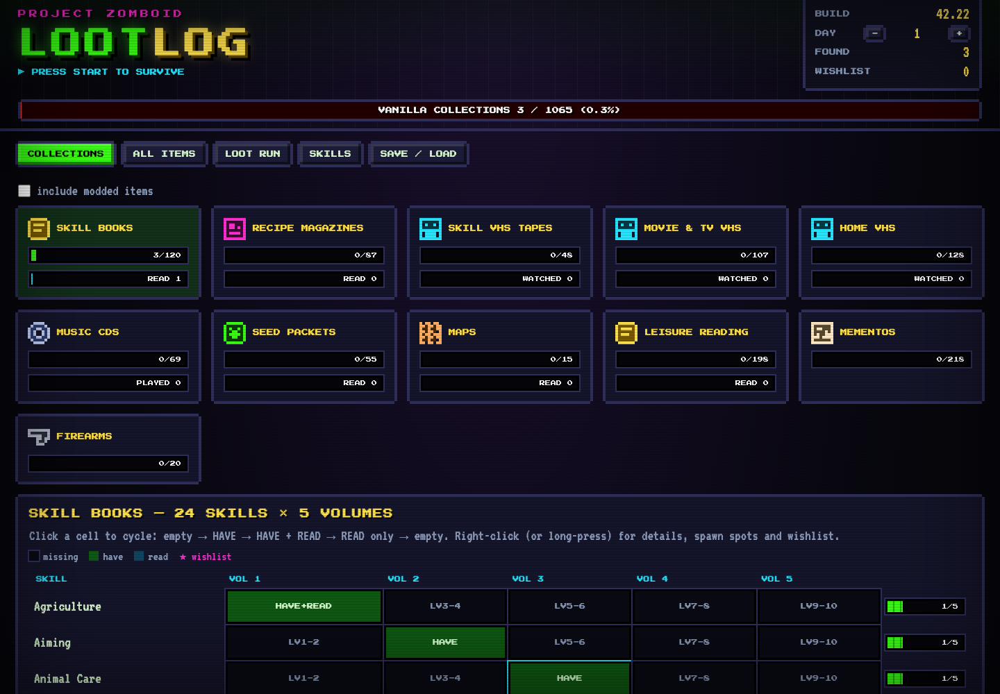
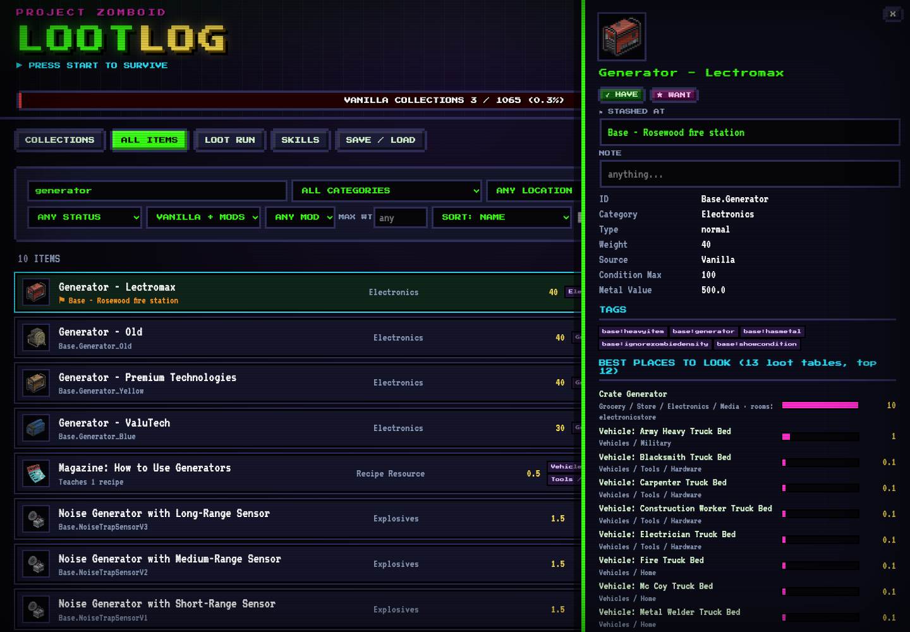
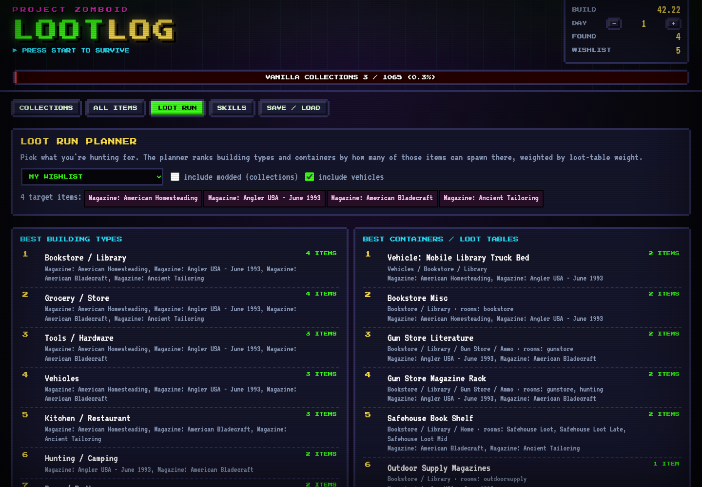
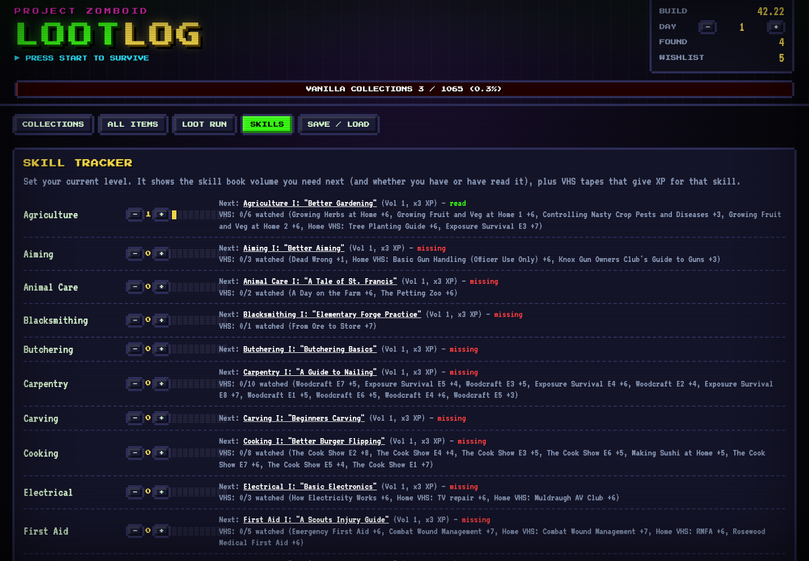

# LOOTLOG: a Project Zomboid B42 item tracker

LOOTLOG is an offline, single-page web app for tracking your Project Zomboid **Build 42** collection. It runs in your browser with no account, no server and no install.

- **Collections:** skill books (volume grid), recipe magazines, skill / movie / home VHS tapes, music CDs, seed packets, maps, leisure reading, mementos and firearms. Mark each one HAVE or READ / WATCHED.
- **All items:** search and filter every item in the game (about 4,900 in vanilla 42.22). Mark items HAVE or WANT, and tag where you stashed them.
- **Loot run planner:** pick what you're hunting for and get ranked places to look, built from the game's own loot tables.
- **Skills:** a simple skill-level tracker.
- **Save / load:** progress saves automatically in your browser, and you can export or import it as a JSON file.
- **Your mods (optional):** rebuild the data from your own game install or dedicated server so modded items show up too.

| Collections | Item search and details |
|---|---|
|  |  |
| **Loot planner** | **Skills** |
|  |  |

> Fan-made. Not affiliated with or endorsed by The Indie Stone. Project Zomboid and its art belong to The Indie Stone.

---

## Quick start (just use it)

1. Download the repo: **Code > Download ZIP** on GitHub (then unzip it), or clone it with git (**Code > Clone** shows the URL).
2. Open `index.html` in your browser. That's it.

The item data ships in `data/items.js` (vanilla B42.22), so this works straight from the folder with nothing installed.

**Tip:** some browsers limit saving on pages opened as a `file://` path. If you see a yellow banner about storage, serve the folder locally instead:

```bash
cd PZ-Loot-Tracker
python3 -m http.server 8000      # Windows: py -m http.server 8000
```
Then open http://localhost:8000. Your progress lives in that browser's localStorage, so use **SAVE / LOAD > Export JSON** for backups or to move to another computer.

Out of the box, items show small 8×8 category glyphs. To see the real in-game icons, follow **Item icons** below. It takes about a minute if you own the game.

---

## Requirements

| For | You need |
|---|---|
| Using the tracker | Any modern browser (Chrome, Edge, Firefox, Safari) |
| Real item icons | Project Zomboid B42 installed (Steam) and Python 3.9+ with Pillow |
| Rebuilding the data (your mods, a new game version) | Python 3.11+, the `lupa` package, and either the game installed locally or SSH access to your dedicated server |
| Running the tests | Python + Playwright (Chromium) |

The commands below use [uv](https://docs.astral.sh/uv/), which installs the Python packages for each command automatically. You can use plain `pip` instead: `python3 -m venv .venv`, then `.venv/bin/pip install -r requirements-build.txt pillow`, then run the scripts with `.venv/bin/python` (on Windows, `.venv\Scripts\python`).

### Where Project Zomboid lives

| | Game install (`media` folder inside) | Your Zomboid user folder (saves, server configs) |
|---|---|---|
| **Windows** | `C:\Program Files (x86)\Steam\steamapps\common\ProjectZomboid` | `C:\Users\<you>\Zomboid` |
| **macOS** | `~/Library/Application Support/Steam/steamapps/common/ProjectZomboid/Project Zomboid.app/Contents/Java` | `~/Zomboid` |
| **Linux** | `~/.local/share/Steam/steamapps/common/ProjectZomboid` (or `~/.steam/steam/...`) | `~/Zomboid` |
| **Dedicated server** | wherever you installed it with SteamCMD (has `media/` and `steamapps/`) | the server user's `~/Zomboid` (configs in `Zomboid/Server/<name>.ini`) |

If Steam uses a different library drive, find it in Steam via **right-click Project Zomboid > Manage > Browse local files**. On macOS that opens the folder containing `Project Zomboid.app`; right-click the app and choose **Show Package Contents** to get inside it.

Steam Workshop mods are downloaded to `<Steam library>/steamapps/workshop/content/108600/` on a PC, or `<server install>/steamapps/workshop/content/108600/` on a dedicated server.

---

## Item icons

The game's icons are The Indie Stone's art, so they **aren't included** in this repo (`assets/icons/vanilla/` is git-ignored). One command unpacks the `Item_*.png` icons from **your own copy of the game** (from the texture atlases in `media/texturepacks/UI.pack`, `UI2.pack`, …) into `assets/icons/vanilla/`. Run it from the repo folder:

| | Auto-detects the default Steam install | Or pass your game folder |
|---|---|---|
| **macOS** | `uv run --with pillow build/extract_icons.py` | `uv run --with pillow build/extract_icons.py --media "$HOME/Library/Application Support/Steam/steamapps/common/ProjectZomboid"` |
| **Windows** (PowerShell) | `uv run --with pillow build/extract_icons.py` | `uv run --with pillow build/extract_icons.py --media "D:\SteamLibrary\steamapps\common\ProjectZomboid"` |
| **Linux** | `uv run --with pillow build/extract_icons.py` | `uv run --with pillow build/extract_icons.py --media ~/.local/share/Steam/steamapps/common/ProjectZomboid` |

`--media` accepts the game folder, the `media` folder itself, or (on macOS) the folder holding `Project Zomboid.app`. No uv? Use `pip install pillow` and then `python3 build/extract_icons.py` (on Windows, `py build\extract_icons.py`).

Then reload the page. The script also writes `assets/icons/vanilla/icons.js`, an index the app reads in the browser, so `data/items.js` never changes. With vanilla 42.22 you get about 4,300 icons, which covers about 92% of items. The rest (mostly furniture "Moveables", whose pictures come from map tiles) keep their 8×8 category glyph. Without extracted icons everything still works, with glyphs instead of pictures.

---

## Rebuild the data (your mods, your server, a new game version)

The build reads the game's item scripts, translations, loot tables and recorded media, plus any Workshop mods you list. It writes `data/items.js` (and copies modded item icons to `assets/icons/mod/`).

### 1. Configure

```bash
cp lootlog.example.toml lootlog.toml     # Windows: copy lootlog.example.toml lootlog.toml
```
Edit `lootlog.toml` (it's git-ignored, so your paths and server address stay private). Every setting can also be set as an environment variable; the sample file lists them, e.g. `PZ_SOURCE`, `PZ_GAME_DIR`, `PZ_MODS_INI`, `PZ_SSH_HOST`.

**Option A: from this computer** (`source = "local"`)

- `game_dir`: your game install. Leave it blank to auto-detect the default Steam location. A local dedicated-server install also works.
- `mods_ini`: optional. Point it at a server config that has `Mods=` and `WorkshopItems=` lines, e.g. `~/Zomboid/Server/servertest.ini` (the file the game writes when you host a co-op game named "servertest"). Leave it blank for vanilla items only.
- `workshop_dir`: optional. Blank means auto-detect `…/steamapps/workshop/content/108600`.

**Option B: from your dedicated server over SSH** (`source = "ssh"`)

- `host`: whatever you'd type after `ssh`, e.g. `pz@203.0.113.10` or a `Host` alias from your `~/.ssh/config`. Optional extras are `port` and `identity_file`.
- `game_dir`: the server install folder on the server, e.g. `/opt/zomboid-server`.
- `mods_ini`: the server's config, e.g. `/home/pz/Zomboid/Server/servertest.ini`.
- `sudo = true` only if your SSH user can't read those files. It uses `sudo -n`, so you need passwordless sudo.

This is **read-only**: the script only runs `tar`, `grep`, `find` and `cat` on the server and streams the files back. It never writes to the server, and it never needs RCON or your admin password. You need the `ssh` command on your PC (built into macOS, Linux and Windows 10/11) with key-based login.

`game_version` (default `"42.22"`) decides which `42.x` folder is used inside B42 mods. Set it to your game version.

### 2. Fetch, extract icons, build

```bash
python3 build/fetch_game_data.py                       # copies what's needed into build/raw (git-ignored)
uv run --with 'lupa>=2.0' python build/build_data.py   # writes data/items.js
```
Then reload `index.html`. **SAVE / LOAD > DATA** shows the game build, item counts and the mods found. Your saved progress is kept, because items are tracked by ID.

The fetch only copies what the build needs: item scripts, English translations, loot-distribution Lua, recorded media and radio from the game, and `mod.info`, scripts, English translations, server Lua and `Item_*.png` icons from each mod.

### What the build reads
| Source | Used for |
|---|---|
| `media/scripts/**/*.txt` (+ mod scripts, B42 `common/` + the highest `42.x` folder ≤ `game_version`) | items, stats, tags, skill books, learned recipes, crafting inputs/outputs ("used in" / "made by") |
| `media/lua/shared/Translate/EN/*.json` (+ mod `*_EN.txt` / `.json`) | display names, recipe names, VHS/CD titles |
| `media/lua/server/Items/*Distribution*.lua`, `Vehicles/VehicleDistributions*.lua` (+ mod loot Lua) | loot tables, room mapping, top-12 spawn spots per item. Evaluated in a sandboxed Lua 5.4 (lupa) |
| `media/lua/shared/RecordedMedia/recorded_media.lua` | every VHS and CD title, rarity, skill XP, mood effects, taught recipes |
| your `mods_ini` (`Mods=`, `WorkshopItems=`) | which mods count as installed |
| item `Icon` (or first `IconsForTexture`) field | stored as the icon name; the browser matches it to `assets/icons/vanilla/` at load time |

Location groups (Bookstore / Library, Gun Store, Police, Military, …) come from keyword rules on loot-table names in `GROUP_RULES` in `build/build_data.py`. Tweak them there.

---

## Tests

```bash
uv run --with playwright playwright install chromium     # once
uv run --with playwright python tests/smoke_test.py
```
This serves the app headlessly, clicks through every tab, checks that progress persists, that export works, that `file://` loads, and (if you've extracted icons) that every icon file exists. With no icons it prints a note and still passes. It also refreshes the images in `screenshots/`.

---

## Troubleshooting

| Problem | Fix |
|---|---|
| Yellow "storage blocked" banner / progress not saving | Your browser blocks localStorage on `file://`. Run `python3 -m http.server 8000` in the folder and use http://localhost:8000, or use Export JSON. |
| Only glyphs, no real icons | Run `build/extract_icons.py` (see **Item icons**) and hard-refresh the page (Ctrl/Cmd+Shift+R). |
| `Could not auto-detect the Project Zomboid install` | Pass `--media` / set `game_dir` yourself (see the table in **Where Project Zomboid lives**). On macOS the media folder is inside the `.app` bundle. |
| `Pillow is required` / `No module named lupa` | Use the `uv run --with …` commands, or `pip install pillow lupa` in a venv. |
| `Reading lootlog.toml needs Python 3.11+` | Upgrade Python (`uv python install 3.12`), or skip the file and use `PZ_*` environment variables. |
| Windows path errors in `lootlog.toml` | Use single quotes for Windows paths: `game_dir = 'D:\SteamLibrary\steamapps\common\ProjectZomboid'`. |
| SSH fetch asks for a password, hangs, or says permission denied | Set up key login first (`ssh your-host` should work with no prompt). If the files belong to another user, set `sudo = true` (needs passwordless sudo) or add your user to the server's group. |
| `enabled mods resolved: 0` or mods listed as "not found" | Check that `mods_ini` has the `Mods=` / `WorkshopItems=` lines and that `workshop_dir` points at `…/workshop/content/108600`. Mods must be downloaded (subscribe in Steam, or start the server once). |
| A mod's items have no icon | The mod doesn't ship an `Item_<Icon>.png`, or it uses a vanilla icon you haven't extracted yet. |
| Data looks out of date after a game update | Re-run the fetch / icons / build steps, and update `game_version`. |

---

## Credits and licence

- Code: MIT, see `LICENSE`.
- Fonts: Press Start 2P and VT323 (SIL Open Font License, bundled in `assets/fonts`).
- Item names, stats and icons are extracted from Project Zomboid © The Indie Stone, from your own copy of the game.
